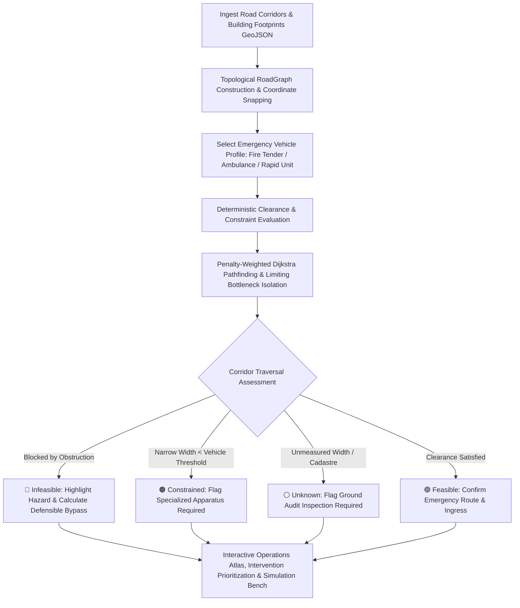
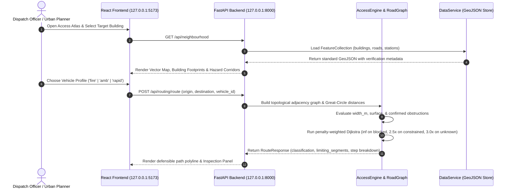
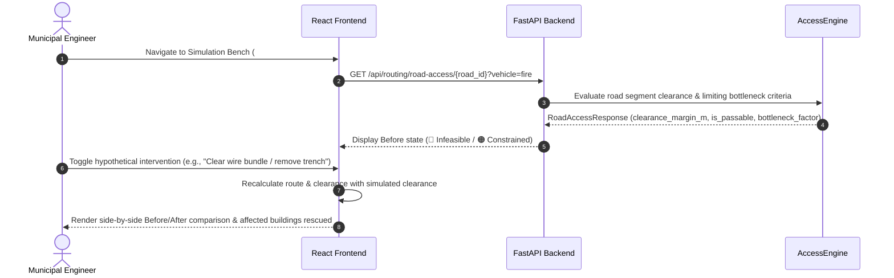

# UNREACHABLE

> An AI-powered, deterministic emergency accessibility intelligence platform designed for dense urban environments and Indian cities. Evaluates physical road geometry, bottleneck pinch-points, overhead utility wire bundles, and apparatus clearances before an emergency unfolds.

[](LICENSE)
[](#technical-details)
[](#technical-details)
[](#technical-details)
[](#technical-details)
[](#technical-details)

---

## Concept

In dense urban environments—from historic core wards in Indian cities to rapidly densifying metropolitan settlements—emergency response times are frequently defeated not by highway traffic, but by the "last 500 meters":

- Narrow residential gullies under 2.5 meters wide where heavy fire water tenders become physically wedged.
- Low-hanging overhead electrical and telecommunication wire bundles snagging apparatus ladders.
- Unmapped bollards, gate curfews, street market encroachments, and construction trenches.
- Municipal GIS datasets that mark a building as "reachable" simply because a centerline road vector exists in OpenStreetMap or cadastre records.

**UNREACHABLE** changes how cities prepare for emergencies:

> *"Know the access. Find the constraint. Fix it before an emergency."*

UNREACHABLE runs on local loopback (`127.0.0.1`). It ingests road corridor geometries, physical width measurements, surface conditions, and confirmed street obstructions. Using a deterministic vehicle clearance and penalty-weighted routing engine, it cross-examines apparatus constraints across Type 1 Water Tenders (≥ 3.5m), ALS Ambulances (≥ 3.0m), and Rapid Response Units (≥ 2.4m).

Crucially, **UNREACHABLE never hallucinates safety**. If a road segment lacks verified width measurements, it is explicitly classified as `unknown` rather than presumed clear. If access is compromised, the platform calculates defensible alternative bypasses, identifies specific limiting bottlenecks, and evaluates hypothetical street intervention fixes before live dispatchers and municipal engineers.

---

## Core Loop



---

## System Architecture

UNREACHABLE operates as a decoupled, high-performance system communicating locally between a Python FastAPI REST engine and a React 18 TypeScript single-page application.

### Ingestion, Topological Graph & Clearance Flow


### Route Assessment & Intervention Simulation Flow


---

## Key Features

- **100% Local-First & Private:** All spatial parsing, topological graph construction, clearance calculations, and route assessments execute locally on `127.0.0.1`. No external APIs, cloud keys, or remote telemetry.
- **Deterministic Clearance Guardrails:** Eliminates probabilistic guesswork. Evaluates exact vehicle clearance metrics—specifically effective corridor width (`width_m`) and physical obstructions (`obstruction`); turning radius, gross weight, and ground clearance exist in vehicle profile metadata and are roadmapped for geometric turn-angle expansion.
- **Penalty-Weighted Routing (Not Naive Shortest-Path):** Uses custom-weighted Dijkstra graph traversal that hard-blocks confirmed obstructions (`inf`), applies a `2.5x` penalty multiplier to constrained corridors, and applies a `3.0x` penalty to unmeasured segments to ensure the calculated route is operationally defensible.
- **Topological Road Graph with Coordinate Snapping:** Converts GeoJSON `LineString` corridors into bidirectional graph edges with junction node coordinates snapped to 6 decimal places (~0.11m precision) and exact Great-Circle Haversine distance computations.
- **Transparent 4-Tier Access Classification:**
  - 🟢 **Feasible (`ok`)**: Corridor meets clearance requirements without known physical bottlenecks.
  - 🟠 **Constrained**: Narrow gully (< 2.5m) requiring specialized apparatus (QRV two-wheelers, relay hoses).
  - 🔴 **Infeasible**: Hard-blocked by confirmed physical obstacles, bollards, construction trenches, or low wire bundles.
  - ⚪ **Unknown**: Unmeasured width or uninspected cadastre data. Explicitly flags ground audit requirements.
- **Separation of Road Arrival vs. Building Ingress:** Explicitly distinguishes road frontage arrival from internal building entrance accessibility (`road_frontage_only` vs. `unconfirmed_entrance`), preventing false assurances of safety.
- **Living Operations Interface:** Designed with curated municipal tokens, high-contrast ink typography, hazard-tape accents, living particle background simulations, floating control docks, and responsive inspection drawers.
- **Intervention Directory & Simulation Bench:** Explore known bottlenecks across the ward, evaluate priority scores, and toggle hypothetical remediation scenarios to preview Before/After access impact.

---

## Technical Details

| Component | Implementation | Description |
|---|---|---|
| **Backend Framework** | [FastAPI](https://fastapi.tiangolo.com/) (Python 3.10+) | Asynchronous, typed REST API server with automated OpenAPI docs |
| **Data Validation** | [Pydantic v2](https://docs.pydantic.dev/) | Strict typing, schema serialization, and request/response validation |
| **Routing & Topology** | Custom Python Graph Engine | Adjacency graph builder with 6-decimal snapping, Haversine metrics, and penalty Dijkstra |
| **Spatial Data** | GeoJSON (RFC 7946 / OGC:CRS84) | Repository-relative spatial datasets representing buildings, roads, and stations |
| **Frontend Framework** | [React 18](https://react.dev/) + [TypeScript 5](https://www.typescriptlang.org/) | Type-safe single-page municipal operations dashboard |
| **Build Tool** | [Vite 6](https://vitejs.dev/) | Fast ES module bundling with hot module replacement |
| **Mapping Engine** | [Leaflet 1.9](https://leafletjs.com/) + [React-Leaflet 4](https://react-leaflet.js.org/) | Hardware-accelerated vector mapping with custom SVG markers and canvas layers |
| **Styling & Design** | [Tailwind CSS 3.4](https://tailwindcss.com/) | Curated emergency palette, glassmorphism tokens, and responsive layout |
| **Icons & Visuals** | [Lucide React](https://lucide.dev/) | Consistent iconography for emergency vehicles, hazards, and operations |
| **Test Suite** | Python `unittest` / `pytest` | 10 comprehensive deterministic test suites validating routing, penalties, and graph topology |

---

## Project Structure

```text
UNREACHABLE/
├── frontend/                          # React 18 + TypeScript web client
│   ├── public/                        # Static public assets
│   ├── src/
│   │   ├── components/                # Modular UI components
│   │   │   ├── AccessLegend.tsx       # 4-tier feasibility classification legend
│   │   │   ├── DetailPanel.tsx        # Slide-over asset and hazard inspector
│   │   │   ├── DisclaimerBanner.tsx   # Transparent prototype safety notice
│   │   │   ├── FloatingDock.tsx       # Floating quick-navigation dock
│   │   │   ├── LivingBackground.tsx   # Canvas particle simulation of city links
│   │   │   ├── MapView.tsx            # Interactive Leaflet map with layer overlays
│   │   │   ├── NavigationHeader.tsx   # Top navigation bar with active route pills
│   │   │   ├── StatsSummary.tsx       # Key metrics summary cards
│   │   │   ├── SvgMap.tsx             # Fallback procedural vector map viewer
│   │   │   ├── TopHeader.tsx          # Status indicator header
│   │   │   └── VehicleSelector.tsx    # Interactive vehicle profile switcher
│   │   ├── pages/                     # Dedicated application screens
│   │   │   ├── AboutPage.tsx          # 4-step methodology, taxonomy & prototype boundaries
│   │   │   ├── AccessAtlasPage.tsx    # Full-viewport operational map with filter controls
│   │   │   ├── AIInspectorPage.tsx    # Visual street hazard inspection bench
│   │   │   ├── BuildingDetailPage.tsx # Building setback, frontage road & apparatus clearance
│   │   │   ├── DashboardPage.tsx      # Unified analytics & operational control room
│   │   │   ├── InterventionsPage.tsx  # Filterable bottleneck catalog & priority scores
│   │   │   ├── IssueDetailPage.tsx    # In-depth bottleneck dossier & affected buildings
│   │   │   ├── OverviewPage.tsx       # KPI overview & "Where to look first" priorities
│   │   │   ├── RoutesPage.tsx         # Station-to-building route evaluator
│   │   │   └── SimulationPage.tsx     # Before/After hypothetical intervention simulator
│   │   ├── services/                  # Typed API client
│   │   │   └── api.ts                 # Fetch client for backend REST endpoints
│   │   ├── types/                     # TypeScript domain models & schemas
│   │   │   └── index.ts               # GeoJSON, Vehicle, Routing, and Stats interfaces
│   │   ├── App.tsx                    # Root hash-routing application container
│   │   ├── index.css                  # Design system tokens, leaflet overrides, and fonts
│   │   ├── main.tsx                   # React DOM entry point
│   │   └── vite-env.d.ts              # Vite environment typings
│   ├── index.html                     # Semantic HTML5 entry template
│   ├── package.json                   # Frontend dependencies and npm scripts
│   ├── tsconfig.json                  # TypeScript compiler configuration
│   └── vite.config.ts                 # Vite bundler configuration
├── backend/                           # Python FastAPI REST application
│   ├── requirements.txt               # Pinned backend dependencies
│   ├── app/
│   │   ├── main.py                    # FastAPI application, CORS middleware, and root info
│   │   ├── api/
│   │   │   └── routes.py              # REST endpoints for health, data, vehicles, and routing
│   │   ├── core/
│   │   │   └── config.py              # Relative dataset path resolution and CORS settings
│   │   ├── models/
│   │   │   ├── routing.py             # Pydantic schemas for routes, steps, and assessments
│   │   │   ├── schemas.py             # Schemas for health, GeoJSON collections, and stats
│   │   │   └── vehicle.py             # VehicleProfile specifications and clearance constants
│   │   └── services/
│   │       ├── access_engine.py       # Deterministic clearance & penalty-Dijkstra routing engine
│   │       ├── data_service.py        # Relative GeoJSON caching & statistics aggregation
│   │       └── graph_service.py       # RoadGraph topology builder & Haversine calculator
│   └── tests/
│       └── test_access_engine.py      # 10 deterministic integration test suites
├── data/
│   └── sample/
│       └── neighbourhood.geojson      # Synthetic Ward 142 demonstration dataset
├── docs/
│   ├── ARCHITECTURE.md                # System flow, graph specifications, and feasibility taxonomy
│   ├── DEVELOPMENT.md                 # Local development commands and workflow
│   └── design-reference/              # Design specifications and HTML reference prototypes
├── .gitignore                         # Git exclusion rules
└── README.md                          # Project documentation
```

---

## Installation & Setup

### Prerequisites

1. **Python 3.10+** (Tested on Python 3.12 and 3.13).
2. **Node.js 18+** and **npm 9+** (Tested on Node v20/v24).
3. **Git**.
4. **No external paid API keys or cloud accounts are required.**

---

### 1. Clone the Repository

```bash
git clone https://github.com/Garg-Pankaj29/UNREACHABLE.git
cd UNREACHABLE
```

---

### 2. Set Up & Start Backend Service

```bash
# Navigate to backend directory
cd backend

# Create and activate Python virtual environment
python3 -m venv .venv
source .venv/bin/activate       # Linux / macOS
# or: .\.venv\Scripts\activate   # Windows PowerShell

# Install dependencies
pip install -r requirements.txt

# Start FastAPI development server
uvicorn app.main:app --host 127.0.0.1 --port 8000 --reload
```

The backend API will initialize on local loopback:
- **API Base**: `http://127.0.0.1:8000/api`
- **Interactive Swagger Docs**: `http://127.0.0.1:8000/docs`
- **Health Verification**: `http://127.0.0.1:8000/api/health`

---

### 3. Set Up & Start Frontend Application

In a separate terminal window:

```bash
# Navigate to frontend directory from project root
cd frontend

# Install npm packages
npm install

# Start Vite development server
npm run dev
```

The web application will launch at:
```
http://127.0.0.1:5173
```

---

## Usage Guide

1. **Explore the Access Atlas (`#/map`):**
   - Open `http://127.0.0.1:5173/#/map` in your browser.
   - Pan and zoom through the interactive municipal map showing building footprints, road corridors, and dispatch bases.
   - Filter corridors by feasibility status (🟢 Feasible, 🟠 Constrained, 🔴 Infeasible, ⚪ Unknown).
2. **Switch Emergency Vehicle Profiles:**
   - Use the vehicle selector dock to toggle between **Fire Tender (Type 1)**, **ALS Ambulance**, and **Rapid Response Unit (QRV)**.
   - Watch the road network colors update dynamically based on whether corridors satisfy the selected vehicle's physical clearance width.
3. **Inspect Infrastructure & Hazards:**
   - Click on any road segment or building footprint.
   - The slide-over inspection panel displays measured road width, surface material, verified status, data source provenance, and confirmed obstructions (e.g., low overhead wire bundles, bollards, construction trenches).
4. **Evaluate Emergency Dispatch Routes (`#/routes`):**
   - Select an origin dispatch station (e.g., `station-01`) and a destination building (e.g., `bldg-201` or `bldg-206`).
   - The routing engine computes the path, flags limiting pinch-points, calculates exact travel distances, and assesses building frontage ingress.
5. **Simulate Infrastructure Fixes (`#/simulation`):**
   - Select a known bottleneck issue (e.g., "Overhead Wire Bundle on North Lane").
   - Toggle the **Simulate Fix** switch to preview how clearing the hazard converts impassable corridors to feasible routes and rescues stranded buildings.
6. **Prioritize Interventions (`#/interventions`):**
   - Access the prioritized list of urban bottlenecks ranked by affected building counts and severity scores to guide municipal engineering budgets.

---

## Design Philosophy

- **Deterministic Code Over Probabilistic Guesswork:** Emergency access is a matter of life safety. Route feasibility and vehicle clearances must be verified by deterministic geometry and physical rules, not hallucinated by generative language models.
- **Explicit Unknowns vs. False Clearances:** A road without width measurements must never be assumed passable. UNREACHABLE explicitly flags unmeasured assets as `unknown` to drive physical ground audits.
- **Traceable Data Provenance:** Every building setback, road width, and bottleneck tracks its origin (`data_source`) and verification state (`unverified_survey`, `ground_verified`, `synthetic_fixture`).
- **Vehicle-Appropriate Dispatch:** Access is relative to apparatus size. A gully impassable for a 16-tonne water tender may be completely accessible for a two-wheeler rapid responder equipped with portable foam extinguishers.

---

## Supported Emergency Vehicle Profiles

| Profile ID | Vehicle Name | Min Width Clearance | Turning Radius (Spec) | Gross Weight (Spec) | Active Clearance Constraints (Code) |
| :--- | :--- | :--- | :--- | :--- | :--- |
| **`fire`** | Fire Tender (Type 1) | **≥ 3.5 m** | 8.5 m | 16.0 t | Effective corridor width (`width_m ≥ 3.5m`) & physical obstructions |
| **`amb`** | Advanced Life Support Ambulance | **≥ 3.0 m** | 6.5 m | 4.5 t | Effective corridor width (`width_m ≥ 3.0m`) & physical obstructions |
| **`rapid`** | Rapid Response Unit (QRV) | **≥ 2.4 m** | 5.0 m | 2.2 t | Effective corridor width (`width_m ≥ 2.4m`) & physical obstructions |

*(Note: Turning radius, gross weight, and ground clearance exist in vehicle profile metadata; the routing engine actively enforces width clearance and physical obstructions deterministically).*

---

## Hackathon Update

The hackathon milestone delivers three decisive, demonstrable capabilities with strictly local, deterministic execution:

1. **Reality Check (`GET /api/routing/compare` & `#/routes`):**
   - Head-to-head comparison between standard naive shortest-path routing (which routes apparatus directly into physical bottlenecks or narrow gullies) and UNREACHABLE's clearance-aware path.
   - Visualized with a red dashed trajectory overlay and pinpoint hazard violation markers.

2. **Topological Single Points of Failure (`GET /api/analysis/critical-roads` & `#/dashboard`):**
   - Automated vulnerability analysis ranking the top 5 most critical road corridors by how many building footprints lose emergency access if that segment is severed.

3. **Bottleneck Impact Simulation (`POST /api/simulate` & `#/simulation`):**
   - Live intervention simulation engine that applies hypothetical fixes (obstruction removal or lane widening) to in-memory dataset copies.
   - Computes exact before/after metrics showing precisely which building footprints are rescued.

4. **Vehicle Gap Scorecard (`GET /api/analysis/vehicle-gap` & `#/dashboard`):**
   - Transparent access gap metrics across Heavy Fire Tender, Ambulance, and Rapid Response units.
   - Follows mathematical safety rules: `Unknown` is excluded and never assumed reachable or unreachable.

5. **Guardrailed AI Explain Briefing (`POST /api/explain` & `#/routes` / `#/inspector`):**
   - Generates plain-language situation briefings using a local LLM (LM Studio at `127.0.0.1:1234/v1`).
   - Validated by strict numeric guardrails against deterministic access facts; falls back automatically to deterministic templates if offline or inaccurate.

6. **Presenter Demo Mode & Offline Replay Fallback (`#/demo`):**
   - 7-step guided presenter controller walking through each core demo milestone.
   - Instant offline replay fallback with fixture snapshots (`frontend/public/fixtures/`) and visible replay status badges.

---

## API Reference Overview

The FastAPI backend exposes structured REST endpoints under `/api`:

| Method | Endpoint | Description |
|---|---|---|
| `GET` | `/api/health` | Service health status, version, and sample dataset reachability |
| `GET` | `/api/stats?vehicle_id=` | Aggregate counts of buildings and road corridors by feasibility state (filterable by vehicle) |
| `GET` | `/api/buildings` | GeoJSON FeatureCollection of building footprints with accessibility statuses |
| `GET` | `/api/roads` | GeoJSON FeatureCollection of road segments with physical widths and hazards |
| `GET` | `/api/neighbourhood` | Complete neighbourhood GeoJSON including stations, roads, and buildings |
| `GET` | `/api/vehicles` | List of all supported emergency vehicle profiles and clearance specifications |
| `GET` | `/api/vehicles/{vehicle_id}` | Detailed clearance thresholds for a specific vehicle |
| `POST` | `/api/routing/route` | Calculate deterministic route with penalty-weighted graph traversal |
| `GET` | `/api/routing/route` | Convenience GET query-parameter routing endpoint for map clients |
| `GET` | `/api/routing/building-access/{id}` | Evaluate building ingress, setback, and fronting corridor access |
| `GET` | `/api/routing/road-access/{id}` | Direct road segment clearance and bottleneck evaluation |
| `GET` | `/api/routing/compare` | Reality Check comparing naive shortest-path vs deterministic clearance routing |
| `POST` | `/api/simulate` | What-if simulation applying hypothetical road widening/clearance to in-memory dataset copy |
| `GET` | `/api/analysis/critical-roads` | Topological single points of failure ranked by buildings compromised |
| `GET` | `/api/analysis/vehicle-gap` | Cross-apparatus access and evidence coverage scorecard |
| `POST` | `/api/explain` | Guardrailed plain-language route explanation using local LLM with template fallback |

---

## Running the Automated Test Suite

UNREACHABLE includes 29 deterministic automated integration tests covering graph topology creation, penalty pathfinding, obstacle avoidance, vehicle gap scoring, simulation, and LLM guardrails:

```bash
# From backend directory with python environment:
cd backend
python -m unittest discover -s tests -q
```

### Test Suite Coverage (29 Deterministic Tests)
1. **`test_access_engine.py` (12 tests)**: Constraint satisfaction, constrained corridors, obstacle hard-blocks, unmeasured corridor penalties, disconnected graphs, invalid station/building IDs, unsupported vehicle handling, unconfirmed building entrances, malformed geometry tolerance, detour routing, and reality-check routing comparisons.
2. **`test_vehicle_gap.py` (9 tests)**: Per-apparatus stats filtering, mathematical vehicle-gap scorecard coverage, critical roads single-points-of-failure ranking, and in-memory what-if simulation (clearing obstructions, widening corridors, resetting).
3. **`test_explain.py` (8 tests)**: Explain endpoint contract, numeric guardrail consistency validation, template fallback when local LLM is unavailable, and protection against simulated hallucinations.

---

## Prototype Boundaries & Disclaimer

> [!WARNING]
> **Prototype Demonstration Notice**: All geographical coordinates, road widths, and hazard fixtures in `data/sample/neighbourhood.geojson` are synthetic models ("Ward 142") created for software architecture validation. They do not constitute official municipal emergency-access certifications or dispatch guarantees.

- **Interactive Demo Entry Point**: The live presentation interface is the React SPA (`npm run dev` at `http://127.0.0.1:5173`, with the 7-step guided presenter controller at `#/demo`). The file in `docs/design-reference/` is a static visual prototype reference.
- **AI Inspector Workflow**: The street photo inspector (`#/inspector`) implements a structured human-in-the-loop observation logging workflow; raw neural vision weights are not bundled on-device in this build.
- **Local-First AI Integration**: Route briefings (`POST /api/explain`) connect to local OpenAI-compatible endpoints (LM Studio at `127.0.0.1:1234/v1`) with strict numeric guardrails and automatic template fallbacks.
- **Phase 1 MVP Scope**: Demonstrates core topological graph construction, deterministic clearance calculation, interactive vector mapping, and simulation interfaces.
- **Future Roadmap**:
  - Direct OpenStreetMap (OSM) Overpass API ingestion with automated lane-width inference.
  - Multi-hop turn-angle penalty calculations for long-wheelbase fire apparatus.
  - On-device vision model integration (Gemma 3 4B / Qwen-VL via LM Studio) for street-level photograph obstruction auditing.
  - Integration with municipal emergency dispatch and GIS cadastre databases.

---

## Contributing

Contributions, feedback, and issue reports are welcome:

1. Fork the repository.
2. Create your feature branch (`git checkout -b feature/osm-ingestion-pipeline`).
3. Commit your changes (`git commit -m "feat: add Overpass API road extractor with width heuristics"`).
4. Push to the branch (`git push origin feature/osm-ingestion-pipeline`).
5. Open a Pull Request.

---

## License

This project is licensed under the MIT License — see the [LICENSE](LICENSE) file for details.
