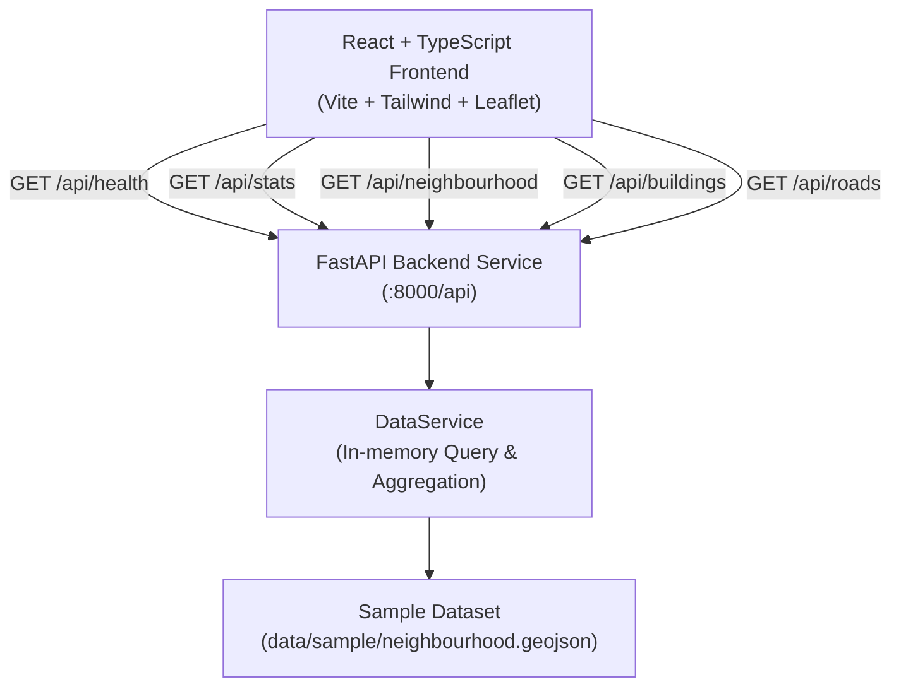

# UNREACHABLE Architecture

## Overview

**UNREACHABLE** is an emergency accessibility intelligence platform tailored for Indian cities and high-density urban environments. It evaluates physical road geometry, bottlenecks, overhead wire clusters, and physical obstructions to determine whether emergency response vehicles can reach specific building footprints before an incident occurs.

---

## High-Level System Architecture

---

## Backend Design (`backend/`)

Built with **FastAPI**, **Pydantic v2**, and standard Python logging. It adheres to a clean layered architecture:

- **`app/core/config.py`**:
  Application configuration, CORS whitelist (`http://localhost:5173`, `http://127.0.0.1:5173`), API versions, and repository-relative dataset path.
- **`app/models/schemas.py`**:
  Strongly-typed Pydantic schemas validating API responses:
  - `HealthResponse`: Service health and dataset availability.
  - `GeoJSONFeature` / `FeatureCollectionResponse`: Standard GeoJSON-compatible data structures.
  - `StatsResponse` & `AccessStatusCounts`: Numerical counts for buildings and road segments classified by feasibility status.
- **`app/services/data_service.py`**:
  Manages dataset lifecycle and computation:
  - Reads `data/sample/neighbourhood.geojson` via relative path resolution.
  - In-memory caching for low-latency queries.
  - Dynamic categorization and aggregation of features by status.
  - Graceful, informative exception handling if files are missing or malformed.
- **`app/api/routes.py`**:
  RESTful endpoints:
  - `GET /api/health`
  - `GET /api/buildings`
  - `GET /api/roads`
  - `GET /api/stats`
  - `GET /api/neighbourhood`
- **`app/main.py`**:
  Application factory configuring restricted CORS middleware and mounting routers under the `/api` prefix.

---

## Frontend Design (`frontend/`)

Built with **React 18**, **TypeScript**, **Vite**, **Tailwind CSS**, and **Leaflet / React-Leaflet**:

### Component Breakdown
1. **`NavigationHeader`**:
   Top navigation bar with municipal emergency GIS branding, tagline, and real-time backend/dataset connectivity indicator.
2. **`DisclaimerBanner`**:
   Persistent notice stating that the data is synthetic and not an official emergency dispatch assessment.
3. **`StatsSummary`**:
   Compact metrics grid derived directly from `/api/stats`, breaking down buildings and roads into feasibility buckets.
4. **`VehicleSelector`**:
   Interactive vehicle evaluation switcher with three illustrative profiles:
   - *Type 1 Fire Water Tender* (Min Width: 2.5m)
   - *Type C / ALS Emergency Ambulance* (Min Width: 2.2m)
   - *Quick Response Unit (QRV / 2-Wheeler)* (Min Width: 1.2m)
5. **`AccessLegend`**:
   Color-coded reference for Feasible (Green), Constrained (Amber), Infeasible (Red), and Unknown (Slate).
6. **`MapView`**:
   Interactive Leaflet map container:
   - Renders OpenStreetMap base tiles with graceful offline fallback notice.
   - Vector styling for roads (line weight, color, dash patterns).
   - Vector polygon fills for building footprints.
   - Custom station markers with quick popups.
   - Dynamic style adjustment when switching vehicle profiles.
7. **`DetailPanel`**:
   Asset inspector displaying comprehensive metadata: Asset ID, feature type, physical road width, surface type, setback, data source, verification status, simulated constraints, and operational notes.
8. **`Direct Feature Directory`**:
   Quick filter strip to immediately inspect specific assets across buildings, roads, and stations.

---

## Data Model & Feasibility Statuses

Features in `data/sample/neighbourhood.geojson` are standard GeoJSON Features with extended properties:

| Feasibility Status | Visual Indicator | Criteria |
| :--- | :--- | :--- |
| **`feasible`** | Green (`#15803d`) | Clear corridor meeting minimum vehicle clearance without known obstructions. |
| **`constrained`** | Amber (`#d97706`) | Narrow lane (< 2.5m) or bottleneck restricting standard heavy apparatus. |
| **`infeasible`** | Red (`#dc2626`) | Blocked by physical barriers, bollards, low overhead cable clusters, or dead ends. |
| **`unknown`** | Slate (`#64748b`) | Unmeasured road width or uninspected cadastral entry requiring ground audit. |

> **Important Boundary Rule**: A building is not marked as verified accessible simply because its road geometry exists. All assets explicitly track `verification_status` and `data_source`.
