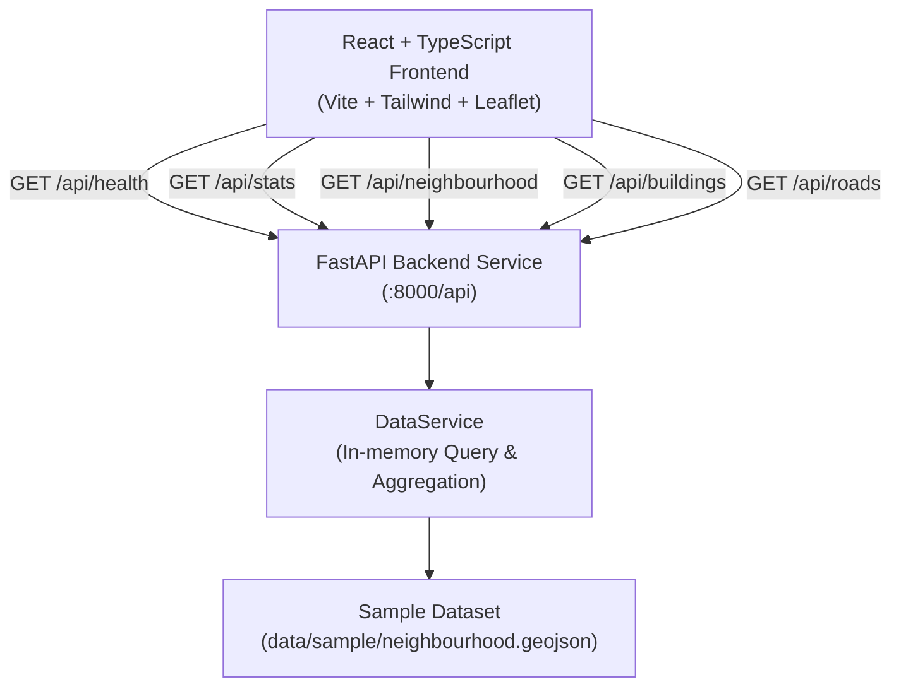

# UNREACHABLE Architecture

## Overview

**UNREACHABLE** is an emergency accessibility intelligence platform tailored for Indian cities and high-density urban environments. It evaluates physical road geometry, bottlenecks, overhead wire clusters, and physical obstructions to determine whether emergency response vehicles can reach specific building footprints before an incident occurs.

---

## High-Level System Architecture

---

## Backend Design (`backend/`)

Built with **FastAPI**, **Pydantic v2**, and standard Python logging. It adheres to a clean layered architecture:

- **`app/core/config.py`**:
  Application configuration, CORS whitelist (`http://localhost:5173`, `http://127.0.0.1:5173`), API versions, and repository-relative dataset path.
- **`app/models/schemas.py`**:
  Strongly-typed Pydantic schemas validating API responses:
  - `HealthResponse`: Service health and dataset availability.
  - `GeoJSONFeature` / `FeatureCollectionResponse`: Standard GeoJSON-compatible data structures.
  - `StatsResponse` & `AccessStatusCounts`: Numerical counts for buildings and road segments classified by feasibility status.
- **`app/models/vehicle.py`**:
  Configurable emergency vehicle profiles (`VehicleProfile`):
  - `fire`: Fire tender (≥ 3.5m clearance, 16.0t, 8.5m turning radius).
  - `amb`: Emergency ambulance (≥ 3.0m clearance, 4.5t, 6.5m turning radius).
  - `rapid`: Rapid response unit (≥ 2.4m clearance, 2.2t, 5.0m turning radius).
  - Tracks evaluated constraints (`width`, `physical_obstruction`) vs unmeasured/unevaluated constraints (`turning_radius`, `overhead_clearance`, `gate_restriction`).
- **`app/models/routing.py`**:
  Pydantic schemas for deterministic route evaluation:
  - `AccessClassification`: `accessible`, `constrained`, `inaccessible`, `unknown`.
  - `SegmentAssessment`, `RouteStep`, `RouteRequest`, `RouteResponse`.
  - `BuildingAccessResponse`: Explicitly distinguishes road arrival from building entrance access (`road_frontage_only` vs `unconfirmed_entrance`).
  - `RoadAccessResponse`: Direct corridor clearance assessment.
- **`app/services/graph_service.py`**:
  Topological road graph (`RoadGraph`):
  - Converts GeoJSON `LineString` road segments into nodes (junction coordinates snapped to 6 decimal places ~ 0.11m precision) and bidirectional traversable edges (`RoadEdge`).
  - Computes exact Great-Circle distances using Haversine formula in meters.
  - Excludes proximity heuristics; relies strictly on physical coordinate connectivity.
- **`app/services/access_engine.py`**:
  Deterministic accessibility and routing engine (`AccessEngine`):
  - Evaluates physical corridor clearance vs vehicle minimum width and confirmed obstructions.
  - Penalty-weighted Dijkstra pathfinding: avoids confirmed impassable segments, applies transparent multipliers to constrained (2.5x) and unmeasured/unknown (3.0x) corridors to optimize for defensible access rather than naive shortest distance.
  - Resolves topological connectivity vs physical blockages (unconstrained BFS fallback).
- **`app/services/data_service.py`**:
  Manages dataset lifecycle and computation:
  - Reads `data/sample/neighbourhood.geojson` via relative path resolution.
  - In-memory caching for low-latency queries.
  - Dynamic categorization and aggregation of features by status.
  - Graceful, informative exception handling if files are missing or malformed.
- **`app/api/routes.py`**:
  RESTful endpoints:
  - `GET /api/health`
  - `GET /api/buildings`
  - `GET /api/roads`
  - `GET /api/stats`
  - `GET /api/neighbourhood`
  - `GET /api/vehicles` & `GET /api/vehicles/{vehicle_id}`
  - `POST /api/routing/route` & `GET /api/routing/route`
  - `GET /api/routing/building-access/{building_id}`
  - `GET /api/routing/road-access/{road_id}`
- **`app/main.py`**:
  Application factory configuring restricted CORS middleware (allowing GET, POST, OPTIONS) and mounting routers under the `/api` prefix.

---

## Frontend Design (`frontend/`)

Built with **React 18**, **TypeScript**, **Vite**, **Tailwind CSS**, and **Leaflet / React-Leaflet**, implementing the visual design from `docs/design-reference/unreachable-demo.html`:

### Visual Identity & Tokens
- **Theme Palette**: Muted sage-green background (`#e4e7df` light, `#151714` dark), high-contrast ink typography (`#1c1f1b` / `#eceee7`), hazard-tape yellow accent (`#ffd60a`), and translucent glass panels with blur (`rgba(228,231,223,0.85)`).
- **Typography**: `Bricolage Grotesque` (Google Fonts) with Inter and system fallbacks.
- **Living Background**: Canvas particle animation simulating emergency vehicles traversing street links and pulsing at bottlenecks.

### Supported Screen Routes
1. **Overview** (`#/` or `#/dashboard`):
   Hero with hazard tape strip, KPI metrics grid, "Where to look first" priority scores table, session activity log, and quick actions.
2. **Access Atlas** (`#/map`):
   Interactive full-viewport map (`MapView`) with floating control overlay (`.ctl`) for search, vehicle profile selection, status filters, and layer toggles. Selected features reveal the inspection panel (`.pan`).
3. **Routes** (`#/routes`):
   Origin dispatch station, destination building, and vehicle profile selector with segment breakdown. Previews candidates while noting that the full multi-hop pathfinding engine is scheduled for Phase 2.
4. **AI Inspector** (`#/inspector`):
   Drag-and-drop JPEG/PNG photo upload with client-side validation (< 10 MB), preview, road association, and observation review. Notes that real local vision reasoning connects to Gemma 3 4B via LM Studio in Phase 3.
5. **Interventions** (`#/interventions`):
   Filterable issue directory with priority scores, status toggles (Review, Verify, Resolve), and breadcrumb navigation.
6. **Simulation** (`#/simulation` or `#/simulation/:id`):
   Bottleneck issue selector and hypothetical fix toggle switch driving Before/After side-by-side comparison panels.
7. **About & Methodology** (`#/about`):
   4-step workflow, explanation of information classes (Unknown, AI-observed, Verified), shared bottlenecks, and prototype limits.
8. **Building Detail** (`#/b/:id`):
   Building setbacks, connected road link, vehicle clearance breakdown table, and direct map link.
9. **Issue Detail** (`#/i/:id`):
   Issue facts, AI observations vs human-verified notes, affected buildings, and simulation link.

---

## Data Model & Feasibility Statuses

Features in `data/sample/neighbourhood.geojson` are standard GeoJSON Features with extended properties:

| Feasibility Status | Visual Indicator | Criteria |
| :--- | :--- | :--- |
| **`feasible` / `ok`** | Green (`#168a5c`) | Clear corridor meeting minimum vehicle clearance without known obstructions. |
| **`constrained`** | Amber (`#e8710a`) | Narrow lane (< 2.5m) or bottleneck restricting standard heavy apparatus. |
| **`infeasible`** | Red (`#d7263d`) | Blocked by physical barriers, bollards, low overhead cable clusters, or dead ends. |
| **`unknown`** | Slate (`#7d837a`) | Unmeasured road width or uninspected cadastral entry requiring ground audit. |

> **Important Boundary Rule**: A building is not marked as verified accessible simply because its road geometry exists. All assets explicitly track `verification_status` and `data_source`.

